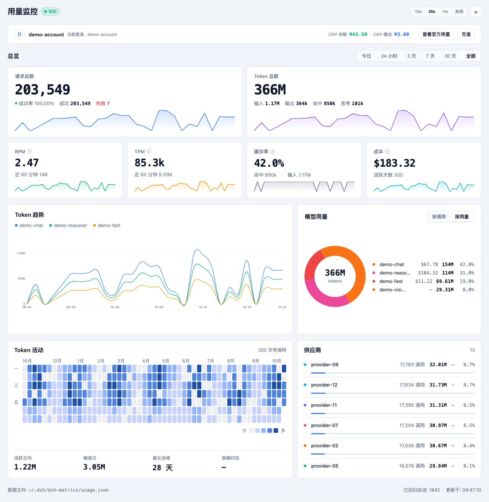

# DSH Metrics

<p align="center">
  <strong>Comprehensive Model Token Usage and Cache Efficiency Dashboard for DeepSeek Harness</strong>
</p>

<p align="center">
  <a href="LICENSE"></a>
  
  
  
</p>

<p align="center">
  <a href="README.md">中文</a> | <strong>English</strong>
</p>

---

## 📖 Overview

**dsh-metrics** is a lightweight, high-reliability model Token usage analytics plugin designed specifically for [DeepSeek Harness (DSH)](https://github.com/deepseek-ai/deepseek-harness).

By intercepting internal model invocation events within the DSH host, it aggregates token consumption in real time and provides a full-featured interactive dashboard directly in the Web sidebar. Whether it is standard conversational rounds, subagent delegations, workflow orchestration, or context compaction, every single Token is trackable and accountable.



---

## ✨ Features

- 🎯 **Comprehensive Call Auditing**: Dual-channel event capture covering all `assistant/message` events, with waterfall interceptors for session title generation, memory compaction, and custom model streams.
- 📊 **Multi-dimensional Breakdown**: Drill down into usage by **Model**, **Provider**, **Project directory (CWD)**, and **Session**, with in-container scrolling and sticky table headers for long lists.
- 🧮 **Metric Tiles**: two primary tiles (requests with success rate / OK / failed, and total tokens with inline composition) plus four tiles (RPM, TPM, cache hit rate, cost), each with a sparkline; six time ranges: today / 24h / 3d / 7d / 30d / all.
- 💵 **Cost from OpenRouter pricing**: fetches and caches OpenRouter's public price list for 24 hours and prices input / output / cache-read / cache-write / reasoning separately; unpriced models are reported explicitly instead of counted as zero.
- ⏱️ **Real RPM / TPM**: the ledger keeps per-minute counters for the last 90 minutes, so RPM / TPM are true wall-clock rates over the last 60 minutes.
- 🗓️ **Token Activity Heatmap**: laid out as weekday × calendar week with month labels on top.
- 🏢 **Provider Breakdown**: requests, tokens, cost and share bar per provider.
- 🍩 **Model Usage Donut**: a donut share plus a legend list (model, usage, share) switchable between by-usage and by-calls.
- 📈 **Multi-model Trend Chart**: one grouped line chart with legend and hover details, with automatically thinned time-axis labels.
- ⚡ **Prompt Cache Efficiency**: Explicitly measures `cacheReadTokens` versus fresh input to calculate the exact cache hit rate, helping optimize prompt engineering and context costs.
- 🔄 **Offline Historical Backfill**: Automatically scans and recovers historical sessions from local disk storage (`.jsonl.zstd`) using native decompression, guaranteeing recovery even without external persistence services.
- 💳 **Official Account Integration**: Seamlessly integrates with DeepSeek account services, displaying account balance, bonus vouchers, and shortcuts to official usage dashboards.
- 🛡️ **Atomic & Safe Storage**:
  - Local JSON storage backed by write debouncing and atomic file replacement to eliminate I/O overhead and prevent corruption.
  - Completely local execution with zero network leakage and no credential exposure.
- 🚀 **Modern Architecture**: Engineered with strict TypeScript modularization following `dsh-context` patterns, built with `tsdown` and verified by sub-second `vitest` test suites.

---

## 📦 Installation

### Method 1: One-line CLI install (Recommended)

```bash
dsh plugin --profile web add @zdt3476/dsh-metrics
```

Or install straight from source (no NPM needed):

```bash
dsh plugin --profile web add github:zdt3476/dsh-metrics
```

### Method 2: Via DSH Plugin Manager

Run inside your DSH shell:

```bash
plugin_manager install_bundle @zdt3476/dsh-metrics
```

### Method 3: Manual Profile Setup

Add the dependency to your profile's `package.json` (e.g. `~/.dsh/profiles/web/package.json`):

```json
{
  "dsh": {
    "profile": {
      "bundles": ["@zdt3476/dsh-metrics"]
    }
  },
  "dependencies": {
    "@zdt3476/dsh-metrics": "^1.0.3"
  }
}
```

Then register the bundle in your profile's `cordis.patch.yml`:

```yaml
- insert:
    - id: dsh-metrics
      name: '@zdt3476/dsh-metrics'
```

Restart DSH, and the **Metrics** icon will appear on the left sidebar. The plugin automatically backfills past session logs on first load.

---

## 📐 Metrics & Formulas

| Metric | Definition | Formula / Note |
| :--- | :--- | :--- |
| **Calls** | Total invocation count | Deduplicated by `(sessionId, turn, step)` |
| **Input Tokens** | Uncached input tokens | Tokens read anew from the context |
| **Cache Read** | Cached input tokens | Tokens served directly from prompt cache |
| **Cache Write** | Cache writing tokens | Tokens newly cached during execution |
| **Output Tokens** | Generated response tokens | Completion text, code, and answers |
| **Reasoning** | Deep thinking tokens | Chain-of-thought tokens produced by reasoning models |
| **Total Tokens** | Overall token volume | Reported usage total or sum of all parts |
| **Hit Rate** | Cache reuse ratio | `CacheRead / (CacheRead + Input)` |

---

## ⚙️ Configuration

All configuration values have sensible defaults. To customize, add an override in `cordis.patch.yml`:

```yaml
- id: dsh-metrics
  config:
    flushDelayMs: 2000        # Debounce delay for disk writes (ms)
    snapshotCacheMs: 3000     # Cache duration for aggregated snapshots (ms)
    retentionDays: 400        # Days of daily bucket history to retain (0 = no pruning)
    maxSessions: 500          # Maximum sessions kept in detail views
    maxTrendSeries: 6         # Max top model lines shown in trend charts
    trackAccount: true        # Whether to poll official account balance
    autoUpdate: true          # Enable self-updating checks
    watchFiles: false         # Enable live hot-reloading for development
```

---

## 🔌 HTTP API Endpoints

The host service exposes internal endpoints for the frontend and automation:

| Method | Endpoint | Description |
| :--- | :--- | :--- |
| `GET` | `/api/dsh-metrics/summary` | Retrieve current aggregated metrics snapshot |
| `GET` | `/api/dsh-metrics/flush` | Force immediate disk flush and return fresh snapshot |
| `GET` | `/api/dsh-metrics/version` | Inspect running plugin version, build ID, and repo |
| `GET` | `/api/dsh-metrics/update/check` | Probe GitHub Releases for new versions |
| `POST` | `/api/dsh-metrics/reload` | Perform in-process hot reload of disk code |

---

## 🛠️ Local Development

```bash
# 1. Install dependencies
pnpm install

# 2. Typecheck and run unit tests
pnpm test

# 3. Compile distribution bundles (outputs to lib/)
pnpm run build

# 4. Watch tests
pnpm run test:watch
```

---

## 📄 License

Distributed under the [MIT License](LICENSE).
